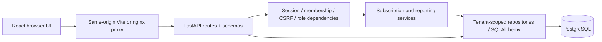

# Architecture

## System boundary

MetricsFlow is a modular monolith. A Vite React SPA calls a versioned FastAPI API; PostgreSQL owns all business records, memberships, sessions, login counters, and audit events. No payment processor, Redis, queue, or external identity service is needed for the MVP.

## Backend responsibilities

- `core/config.py`: environment validation; refuses insecure production cookies.
- `core/database.py`: SQLAlchemy engine and request-scoped transactions. All work commits together or rolls back. Routes flush before returning newly created records.
- `core/security.py`: Argon2 verification, SHA-256 session-token digests, authenticated principal resolution, session expiry, CSRF comparison, and admin enforcement.
- `models`: UUID-backed relational tables with foreign keys, indexes, uniqueness, and status/price/currency checks.
- `schemas`: Pydantic inputs/outputs, bounded prices and lengths, safe error envelopes, timezone and email validation.
- `repositories/records.py`: scoped lookups, paginated queries, joined response mapping, and audit creation.
- `services/subscriptions.py`: allowed lifecycle transitions and immutable price snapshots.
- `services/analytics.py`: reporting boundaries, Decimal normalization, cohort calculations, and daily/monthly buckets.
- `api`: HTTP routing, request filters, authorization dependencies, schemas, and response codes.

Simple queries live in their domain route where another wrapper would add little value. Shared query and business rules are extracted. There is no generic CRUD framework. Customer/subscription/transaction details join related names in bulk rather than doing per-row relationship loads.

## Data model

Users belong to organizations through memberships with `admin` or `viewer` roles. Opaque sessions reference a membership, giving each session exactly one verified organization. Login optionally accepts an organization UUID but verifies membership before selecting it. The UI displays the current organization rather than offering arbitrary tenant switching.

Customers, plans, subscriptions, transactions, and audit events carry an indexed organization ID. Every protected query uses the principal’s organization. Resource lookups in another organization return the same 404 as an unknown ID. Creating a subscription checks both customer and plan ownership before writing. The seed supplies historical simulated records. An admin-only simulated-payment endpoint adds replay-safe paid entries from an owned billable subscription; no processor is invoked.

Subscriptions store their own price, interval, currency, and plan-name snapshot. Existing subscriptions do not join the live plan for financial reporting. Customer archival retains all relationships and does not alter billing. Ended subscriptions cannot be reactivated; create a new subscription to begin a new billing relationship. This preserves historical active windows without a separate price-version service.

Timestamps are stored as UTC in timezone-naive SQL columns under an explicit UTC-only application contract. Reporting converts organization-local date boundaries to UTC using IANA `zoneinfo`. See [METRICS.md](METRICS.md) for interval semantics.

## Authentication and request security

Passwords use Argon2id with the maintained library defaults and rehash on login when required. Sessions use 256 bits of randomness; only a token digest is stored in the database. Cookies are HTTP-only, SameSite=Lax, path `/`, expire after the configured SESSION_HOURS (eight hours by default), and require `Secure` in production. Logging out deletes the server session and clears the cookie. Login rotates a presented prior session.

`GET /me` returns a CSRF token stored only in frontend memory. Every authenticated mutation checks `X-CSRF-Token` with constant-time comparison. Every mutation, including login, also requires an exact allowed `Origin`. Browser requests are same-origin through the development or production proxy, so no permissive CORS layer is necessary.

Login attempts use hashed email/IP keys in PostgreSQL, with a rolling 15-minute retention window. Limits are ten attempts per email and forty per direct client IP; successful authentication resets the email counter. PostgreSQL transaction advisory locks serialize counter updates across API workers. The app ignores untrusted forwarded IP headers. The production topology trusts only nginx at 172.30.0.10; nginx replaces forwarding headers and trusts the separately documented host TLS peer. See DEPLOYMENT.md for the exact chain and topology contract.

CSV export validates filters and tenant scope, bounds exports to 50,000 rows, quotes CSV fields, and prefixes potentially executable spreadsheet cells. Request logs contain method, path, status, duration, and an internal request ID; passwords, cookies, request bodies, and query-string email searches are not logged. Validation errors do not echo submitted input. Unexpected errors receive a generic response.

## Frontend design

Routes are lazy-loaded by feature. TanStack Query owns server state and invalidates customer, subscription, and analytics queries after mutations. A shared client owns credentials, CSRF headers, errors, and typed response contracts. Authentication tokens never enter localStorage; localStorage contains only the appearance preference.

The design uses neutral surfaces, restrained blue, consistent spacing, tabular financial figures, semantic HTML, visible focus, reduced-motion support, and responsive tables. Owned button/dialog components follow shadcn’s composition approach. Radix supplies dialog focus containment, Escape handling, and accessible title/description relationships. Charts offer tooltips plus readable data tables or textual legends. Viewers receive a read-only interface, while the backend remains the actual permission boundary.

## Verification and operational limits

Unit/API tests run in isolated SQLite by default and can run against a dedicated PostgreSQL `_test` database. Playwright uses a separate PostgreSQL `_e2e` database that it resets, migrates, and seeds before launching its own servers. Guards prevent these tools from clearing the development database.

The reporting implementation executes a fixed number of scoped queries, then buckets records in memory. This is appropriate for the portfolio dataset and avoids N+1 queries, but a high-volume tenant would benefit from SQL aggregates and profiling. There is no premature cache. Exports are bounded; customer and ledger pages use server pagination. Production needs infrastructure-specific backups, TLS, telemetry, release coordination, and administrative user provisioning. The repository supplies deployable containers, not a claim of live production operation.

## Documentation consulted

- [Vite getting started](https://vite.dev/guide/)
- [Tailwind Vite integration](https://tailwindcss.com/docs/installation/using-vite)
- [shadcn Vite setup](https://ui.shadcn.com/docs/installation/vite)
- [TanStack Query React documentation](https://tanstack.com/query/latest/docs/framework/react/overview)
- TanStack Table 9.3.1’s installed type declarations and bundled React setup/migration guidance
- [React Hook Form useForm](https://react-hook-form.com/docs/useform)
- [FastAPI dependency cleanup](https://fastapi.tiangolo.com/tutorial/dependencies/dependencies-with-yield/)
- [SQLAlchemy 2.0 sessions](https://docs.sqlalchemy.org/en/20/orm/session_basics.html)

## Review hardening

The browser is a single selected workspace UI, not an organization/member administration product. After password verification, login returns verified workspace options when an account has multiple memberships. The browser submits the selected ID with the credentials before a session is issued. Plan analytics use plan IDs together with historical labels, rather than grouping only by name. Customer PATCH applies only explicitly supplied fields. Simulated payment writes use a persistent tenant-scoped unique idempotency key plus a nested transaction to replay simultaneous duplicates safely.

Runtime and development Python locks are separate. CI runs mypy across application code, branch-aware pytest coverage and V8 frontend coverage with explicit floors. PostgreSQL-only tests use independent request sessions to exercise concurrent login counters and payment retries. Shared UI styling uses Tailwind utilities/theme tokens; domain CSS remains for the bespoke visualizations and layout.
